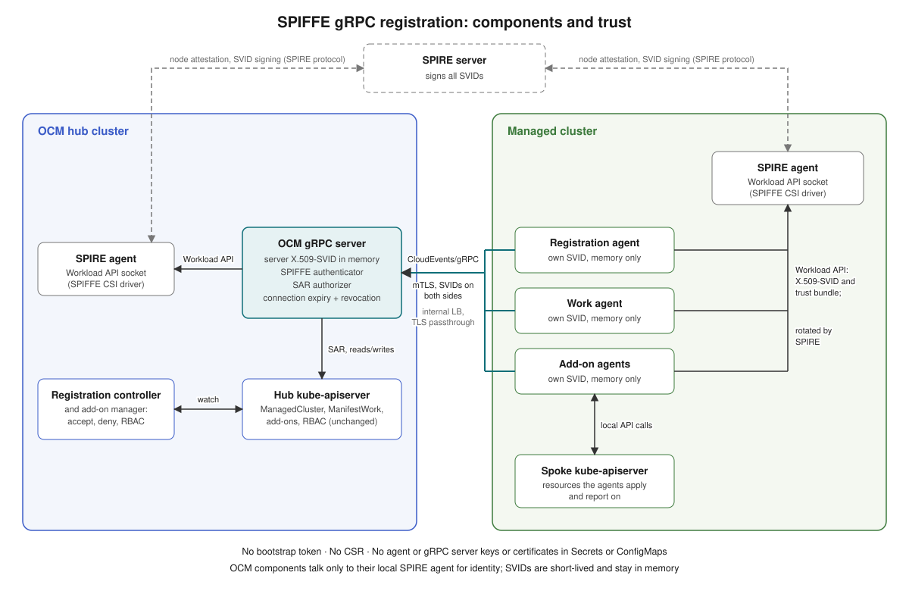
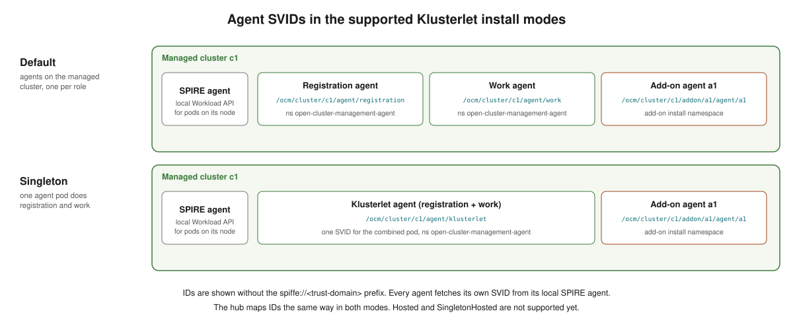
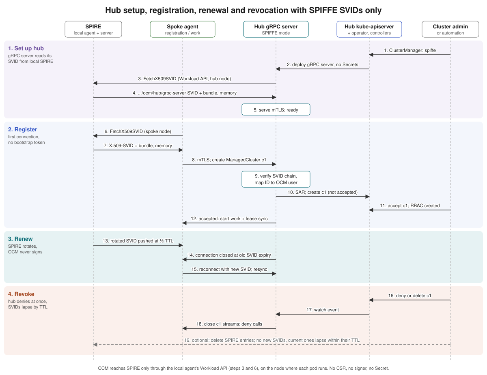

# SPIFFE gRPC registration

## Release Signoff Checklist

- [ ] Enhancement is `implementable`
- [ ] Design details are appropriately documented from clear requirements
- [ ] Test plan is defined
- [ ] Graduation criteria for dev preview, tech preview, GA
- [ ] User-facing documentation is created in [website](https://github.com/open-cluster-management-io/open-cluster-management-io.github.io/)

## Summary

This proposal adds a new registration driver, `spiffe`, in which every OCM agent identity is a
short-lived [SPIFFE](https://spiffe.io/) SVID issued by [SPIRE](https://spiffe.io/docs/latest/spire-about/).
Klusterlet agents and add-on agents connect to the hub gRPC server over mutual TLS with their own
X.509-SVIDs, and the hub gRPC server authenticates with its own X.509-SVID. Registration, renewal
and revocation all work without a bootstrap token, without a CertificateSigningRequest, without a
hub signing key, and without any Secret or ConfigMap that holds a private key, public key or
certificate. The only identity service OCM talks to is the local SPIRE agent, through the SPIFFE
Workload API.

The driver supports the `Default` and `Singleton` Klusterlet install modes and applies the same
model to add-ons. The `Hosted` and `SingletonHosted` modes are not supported: the Klusterlet API
refuses `spiffe` in them. Supporting them is a feature to do later.

The driver is new. It reuses the CloudEvents-over-gRPC transport, the per-resource gRPC services
and the SubjectAccessReview authorizer from [gRPC based registration](../141-grpc-based-registration/README.md),
but replaces its entire identity layer.

## Motivation

The existing registration drivers (`csr`, `grpc`, `awsirsa`) and add-on registration drivers
(`csr`, `token`) all leave long-lived or reusable credentials in OCM's hands:

- A bootstrap kubeconfig or bootstrap token must be distributed to each managed cluster and is
  valid until someone removes it.
- The `csr` and `grpc` drivers have the hub sign client certificates, so the hub holds a signing
  key (`signer-secret`) and the hub gRPC server holds a serving certificate in a Secret.
- The agent's private key and certificate are written to the `hub-kubeconfig-secret`, and each
  add-on's credentials to `<addon>-hub-kubeconfig` or `<addon>-<signer>-client-cert` Secrets.
  Anyone who can read those Secrets can act as the cluster or the add-on.
- Renewal is OCM's job (CSR rotation), and revoking a cluster or add-on does not invalidate a
  certificate that was already issued.

Many platforms already run SPIRE as their workload identity system. In those environments the
platform wants a single place that issues and rotates identities, short credential lifetimes, and
no key material at rest. OCM should be able to plug into that model instead of running its own
certificate authority.

### Goals

- Add a `spiffe` registration driver to the hub (`ClusterManager`) and the agent (`Klusterlet`).
- Use only SPIRE-issued SVIDs for every Klusterlet agent, every add-on agent and the hub gRPC
  server, for the whole lifecycle: register, renew, revoke and unjoin.
- Support the `Default` and `Singleton` Klusterlet install modes.
- Support add-ons with the same model: each add-on agent registers, renews and is revoked using
  only its own SVID.
- Agents hold only short-lived SVIDs, in memory. Nothing OCM creates stores key material.
- OCM does not create Secrets or ConfigMaps for private keys, public keys or certificates, and does
  not sign anything.
- Apart from the local SPIRE agent's Workload API, OCM contacts no other identity or key service
  (no KMS, cloud identity provider, OIDC endpoint or SPIRE server API).
- Keep the hub-side user experience unchanged: ManagedCluster acceptance, add-on enablement, RBAC,
  ManifestWork and add-on APIs work as today.
- Allow existing clusters to move to the new driver one at a time.

### Non-Goals

- Installing, configuring or operating SPIRE. SPIRE topology, node attestation and registration
  entries are the platform's responsibility; this proposal only defines what OCM expects of them.
- Changing the existing `csr`, `grpc` or `awsirsa` drivers, or the `csr` and `token` add-on
  drivers.
- Giving agents or add-ons a kubeconfig for the hub kube-apiserver. In this mode they reach the
  hub only through the gRPC server.
- `customSigner` add-on registrations. They exist to have the hub sign client certificates; in
  this mode an add-on that needs a client certificate uses its SVID instead.
- JWT-SVID authentication (see [Alternatives](#alternatives)).
- The `Hosted` and `SingletonHosted` install modes. There the agents run on a management cluster
  and need a credential for the managed cluster's kube-apiserver, which today is a kubeconfig in a
  Secret (`external-managed-kubeconfig`). That breaks the rule that OCM keeps no long-lived
  credentials. **Feature to do:** support the hosted modes with SVIDs only.

## Proposal



- **SPIRE** issues every identity. A SPIRE agent runs on each node of the hub and the managed
  clusters, and exposes the Workload API through the SPIFFE CSI driver.
- **Each OCM workload gets its own SVID.** The hub gRPC server, every Klusterlet agent and every
  add-on agent fetch their own X.509-SVID and trust bundle from the Workload API of the cluster
  they run on. SPIRE pushes a new SVID before the current one expires.
- **The hub gRPC server** serves TLS with its SVID, requires a client SVID from the configured
  trust domain, maps the client's SPIFFE ID to an OCM user and groups, and authorizes every
  CloudEvent with SubjectAccessReview, as today.
- **Agents** verify that the server presents the exact hub SPIFFE ID, so a load balancer or a
  certificate from the same trust domain cannot impersonate the hub.

### SPIFFE ID scheme

The hub derives the OCM identity from the path of the client's SPIFFE ID, so no per-cluster
configuration is needed on the hub. The user and group names match what the `csr` and `grpc`
drivers and the add-on framework use today, so the existing RBAC created by the registration
controller and the add-on manager, and the existing identity checks, apply without change.

| Workload | SPIFFE ID | OCM user | OCM groups |
| --- | --- | --- | --- |
| Hub gRPC server | `spiffe://<td>/ocm/hub/grpc-server` | n/a (server) | n/a |
| Registration agent (`Default`) | `spiffe://<td>/ocm/cluster/<cluster>/agent/registration` | `system:open-cluster-management:<cluster>:registration` | `system:open-cluster-management:<cluster>`, `system:open-cluster-management:managed-clusters`, `system:open-cluster-management:spiffe-agents` |
| Work agent (`Default`) | `spiffe://<td>/ocm/cluster/<cluster>/agent/work` | `system:open-cluster-management:<cluster>:work` | same as above |
| Klusterlet agent (`Singleton`) | `spiffe://<td>/ocm/cluster/<cluster>/agent/klusterlet` | `system:open-cluster-management:<cluster>:klusterlet` | same as above |
| Add-on agent (both modes) | `spiffe://<td>/ocm/cluster/<cluster>/addon/<addon>/agent/<agent>` | `system:open-cluster-management:cluster:<cluster>:addon:<addon>:agent:<agent>` | `system:open-cluster-management:cluster:<cluster>:addon:<addon>`, `system:open-cluster-management:addon:<addon>` |

`<td>` is the trust domain configured on the hub. The hub rejects any SVID whose trust domain or
path does not match this scheme, any request where the cluster in the event differs from the
cluster in the SVID, and any add-on request where the add-on in the event differs from the add-on
in the SVID.

The platform must make sure SPIRE only issues `.../cluster/<cluster>/...` IDs to workloads that
really belong to cluster `<cluster>`, for example by binding registration entries to the node
attestation of the SPIRE agents that run that cluster's agents. See
[Risks and Mitigation](#risks-and-mitigation).

### Install modes



The driver supports two of the four Klusterlet install modes. In both, every agent runs on the
managed cluster and gets its SVID from the local SPIRE agent, on the node where the agent's pod
runs. The hub treats both modes the same way: it sees an SVID, maps it, and authorizes the
request.

| Mode | Klusterlet agent pods run on | Klusterlet SVIDs |
| --- | --- | --- |
| `Default` | Managed cluster, `open-cluster-management-agent` | `agent/registration`, `agent/work` |
| `Singleton` | Managed cluster, `open-cluster-management-agent` | `agent/klusterlet` |
| `Hosted` | Not supported | |
| `SingletonHosted` | Not supported | |

- Each Deployment mounts the local Workload API with a `csi.spiffe.io` volume and has no bootstrap
  or hub-kubeconfig Secret volume.
- In `Singleton` mode the one agent pod runs registration and work and has a single SVID. Hub RBAC
  is granted to the cluster's groups, so one identity covers both roles.
- The agents reach the managed cluster's kube-apiserver with their in-cluster ServiceAccounts, as
  today. No kubeconfig for the managed cluster is stored.
- Add-on agents run on the managed cluster. Like the Klusterlet agents, they get their SVIDs from
  the local SPIRE agent.
- **`Hosted` and `SingletonHosted` are not supported.** In those modes the agents run on a
  management cluster and reach the managed cluster's kube-apiserver with a kubeconfig the user
  stores in a Secret (`external-managed-kubeconfig`), which this driver must not rely on. The
  Klusterlet API refuses `authType: spiffe` with either mode, and the klusterlet operator deploys
  no agent for such a Klusterlet. **Feature to do:** support both hosted modes with SVIDs only,
  including access to the managed cluster.

### Lifecycle



The steps are the same in both supported install modes. "Registration agent" below means the
registration agent in `Default` mode, and the Klusterlet agent in `Singleton` mode.

**Set up the hub.**

1. The platform gives the hub gRPC server pod its identity: SPIRE agents run on the hub nodes, and a
   SPIRE registration entry maps the gRPC server pod (by namespace, ServiceAccount and label) to
   `spiffe://<td>/ocm/hub/grpc-server`. OCM does not create this entry.
2. The admin configures the `ClusterManager` with the `spiffe` driver, for example with
   `clusteradm init`.
3. The cluster-manager operator deploys the gRPC server with a `csi.spiffe.io` volume for the
   local Workload API and no Secret volumes. It creates no signing key, serving certificate,
   bootstrap ServiceAccount or token.
4. The gRPC server opens a Workload API `X509Source` and receives, in memory, its own X.509-SVID and
   the trust bundle for the trust domain, plus any federated trust domains. It reports not ready
   until the first SVID arrives.
5. It serves mTLS: it presents its SVID and verifies client SVIDs against the trust bundle. SPIRE
   pushes rotated SVIDs and bundle updates over the same stream, and new handshakes use them.
   The server also starts watching `ManagedCluster` and `ManagedClusterAddOn` for revocation.

Reading its own SVID and the trust bundle from the local Workload API is all the hub does with
SPIRE. It does not call the SPIRE server, create registration entries, mint SVIDs for agents or
publish a CA bundle for agents; agents get the trust bundle from their own local Workload API.

**Register.**

1. The registration agent fetches its X.509-SVID and trust bundle from the local Workload API and
   keeps them in memory.
2. It dials the hub gRPC endpoint from the `Klusterlet` spec over mTLS, accepting only the
   configured hub SPIFFE ID.
3. The hub verifies the client SVID against the trust bundle from its own Workload API and maps
   the SPIFFE ID to the OCM user and groups above.
4. The agent publishes a create for `ManagedCluster/<cluster>`. The hub allows it only when the
   name equals the cluster in the SVID. The new cluster has `hubAcceptsClient: false`.
5. A cluster admin or automation accepts the cluster, exactly as today. The registration
   controller creates the cluster namespace and RBAC for the cluster's groups.
6. The agent sees the accepted status and starts lease, status, ManifestWork and add-on sync.

There is no bootstrap stage. Before acceptance, the agent's identity is authorized only to create,
get, list and watch its own `ManagedCluster`, through a ClusterRole bound to
`system:open-cluster-management:spiffe-agents`, a group only the hub's SPIFFE authenticator gives.
The agents of the `csr` and `grpc` drivers carry `system:open-cluster-management:managed-clusters`
in their certificates too, so a role bound to that group would also reach them and give them every
`ManagedCluster`. The hub's CSR approval accepts no other group in a certificate, so they can't get
`spiffe-agents`.

**Renew.**

- SPIRE rotates each SVID, by default at half of its TTL, and pushes it over the Workload API. The
  agent's TLS configuration reads the current SVID for each new handshake.
- A gRPC stream authenticates once, when the connection is established. The hub therefore records
  the client SVID's expiry for each connection and closes the connection when that SVID expires.
  The client reconnects with its current SVID and resyncs, as it already does after a reconnect.
- The hub gRPC server renews its own serving SVID the same way.
- OCM never signs, stores or rotates a certificate.

**Revoke.**

- **In OCM, immediate.** The hub gRPC server watches `ManagedCluster` and, when a cluster is
  denied (`hubAcceptsClient: false`) or deleted, or its trust-domain pin changes, closes every
  open connection whose SVID belongs to that cluster, including its add-on agents. On reconnect,
  the authorizer then allows only:
  - for a denied cluster, its own `ManagedCluster`, lease and events, so the registration agent
    sees when the cluster is accepted again. Work and add-on requests are refused;
  - for a cluster being deleted, `ManifestWork` requests from its work agent (or singleton agent),
    so it can remove what the cluster's `ManifestWork`s applied and the deletion can finish. Every
    other request, and every request of its registration and add-on agents, is refused.
- **In SPIRE, within one TTL.** Deleting the cluster's registration entries, or evicting its SPIRE
  agents, stops new SVIDs. SVIDs already issued stop working when they expire. Short TTLs are the
  revocation mechanism; there is no CRL in this design.
- **Trust domain compromise.** SPIRE CA rotation and bundle updates reach OCM through the
  Workload API, with no OCM change.

**Unjoin.** Deleting the `ManagedCluster` on the hub and the `Klusterlet` on the managed cluster
removes everything. There are no OCM Secrets to clean up.

### Add-ons

Add-ons follow the same model. Each add-on agent has its own SVID; the registration agent no
longer obtains credentials on the add-on's behalf.

**Register.**

1. The add-on is enabled on the hub as today, by creating the `ManagedClusterAddOn`. The add-on
   manager sets the add-on's `kubeClient` registration and creates its hub RBAC from the add-on's
   permission configuration, bound to the add-on's user and groups.
2. On the managed cluster, the registration agent sees the registration and, with the `spiffe`
   add-on driver, creates no CSR, no token request and no Secret. It sets
   `status.registrations[].kubeClient.driver: spiffe` and the `RegistrationApplied` condition.
3. The add-on agent fetches its own SVID (`.../cluster/<cluster>/addon/<addon>/agent/<agent>`)
   from the local Workload API and connects to the hub gRPC server over mTLS, as the Klusterlet
   agents do.
4. The hub maps the SVID to the add-on user and groups, which are the default `kubeClient`
   subject, so the add-on's existing hub RBAC applies.

If an add-on sets a custom `kubeClient` subject that does not match the mapping for its SPIFFE ID,
the add-on manager sets `RegistrationApplied` to false with a clear reason, because no SVID can
carry that subject.

**Renew.** Exactly as for the Klusterlet agents: SPIRE rotates the add-on agent's SVID, and the
hub closes connections whose SVID has expired.

**Revoke.**

- Disabling the add-on (deleting the `ManagedClusterAddOn`) makes the add-on manager remove its
  RBAC, and the hub gRPC server closes the add-on agent's open connections for that cluster.
- Denying or deleting the cluster closes the connections of all its add-on agents.
- Deleting the add-on's SPIRE registration entries stops new SVIDs; existing ones lapse within
  their TTL.

**Add-on framework.** The add-on framework gets a helper that builds the add-on agent's
CloudEvents clients from a Workload API `X509Source`, so add-on authors do not handle SVIDs
directly.

### Implementation Details/Notes/Constraints

The examples below use trust domain `ocm-hub.example.org`, managed cluster `cluster1` and add-on
`my-addon`.

#### API

**Hub.** The `ClusterManager` gets a new driver, `spiffe`. Only the trust domain is required; the
other fields have defaults.

```yaml
apiVersion: operator.open-cluster-management.io/v1
kind: ClusterManager
spec:
  registrationConfiguration:
    registrationDrivers:
    - authType: spiffe
      spiffe:
        trustDomain: ocm-hub.example.org
        # Optional. Trust domains the agents may be in, besides trustDomain, which is
        # always accepted. See "Trust domains".
        agentTrustDomains:
        - east.example.org
        # Optional. Default: spiffe://<trustDomain>/ocm/hub/grpc-server
        serverSPIFFEID: spiffe://ocm-hub.example.org/ocm/hub/grpc-server
        # Optional. Default: unix:///spiffe-workload-api/spire-agent.sock
        workloadAPISocket: unix:///spiffe-workload-api/spire-agent.sock
        # Optional. Default: 24h. Must be at least the longest SVID TTL SPIRE
        # issues to OCM agents. The delete guard waits this long; see
        # "Deleting a cluster".
        maxSVIDLifetime: 24h
        # Optional. Default: 5m. Allowed clock difference between SPIRE and the
        # hub, used by the SVID validity check and added to the delete guard.
        maxClockSkew: 5m
        # Optional. The layout of agent SPIFFE IDs; every Klusterlet must use the
        # same templates. See "ID templates".
        agentIDTemplate: "spiffe://{trustDomain}/ocm/cluster/{cluster}/agent/{role}"
        addOnAgentIDTemplate: "spiffe://{trustDomain}/ocm/cluster/{cluster}/addon/{addon}/agent/{agent}"
        # Optional. With the ManagedClusterAutoApproval feature gate, clusters whose
        # agent's SPIFFE ID matches are accepted on their first join. See "Acceptance".
        autoApprovedIdentities:
        - spiffe://ocm-hub.example.org/ocm/cluster/*/agent/registration
  serverConfiguration:
    endpointsExposure:
    - protocol: grpc-spiffe  # the SPIFFE listener; see gRPC server below
      grpc:
        type: loadBalancer   # must pass TLS through; see Risks
```

**Managed cluster.** The `Klusterlet` says where the hub is and which SPIFFE ID the hub must
present. Neither value is secret, so they go in the spec instead of a bootstrap Secret. The same
fields work in both supported install modes, `Default` and `Singleton`. Add-ons are switched to
SPIFFE with the existing `addOnKubeClientRegistrationDriver` field.

```yaml
apiVersion: operator.open-cluster-management.io/v1
kind: Klusterlet
spec:
  clusterName: cluster1
  deployOption:
    mode: Default            # or Singleton; Hosted and SingletonHosted are refused
  registrationConfiguration:
    registrationDriver:
      authType: spiffe
      spiffe:
        hubEndpoint: ocm-grpc.hub.internal:443
        hubSPIFFEID: spiffe://ocm-hub.example.org/ocm/hub/grpc-server
        workloadAPISocket: unix:///spiffe-workload-api/spire-agent.sock
        # Optional. The agents' own trust domain. Default: the trust domain of hubSPIFFEID.
        trustDomain: ocm-hub.example.org
        # Optional. Must equal the ClusterManager's templates.
        agentIDTemplate: "spiffe://{trustDomain}/ocm/cluster/{cluster}/agent/{role}"
        addOnAgentIDTemplate: "spiffe://{trustDomain}/ocm/cluster/{cluster}/addon/{addon}/agent/{agent}"
        # Required: ValidatingAdmissionPolicy (Kubernetes 1.30 or later) or ValidatingWebhook.
        # See "How the rules are enforced".
        admissionEnforcement: ValidatingAdmissionPolicy
    addOnKubeClientRegistrationDriver:
      authType: spiffe       # required when registrationDriver.authType is spiffe
```

**Admission enforcement.** `admissionEnforcement` says how the klusterlet operator enforces the
admission rules that guard the agents' SVIDs (see Operators): `ValidatingAdmissionPolicy`, which
needs Kubernetes 1.30 or later, or `ValidatingWebhook`, served by the operator, which works on
every version. Both enforce the same rules. The field is required: the user chooses, and
`ValidatingAdmissionPolicy` on an older cluster is refused as an unsupported Kubernetes version. A
change moves the cluster from one to the other without a gap.

**ID templates.** `agentIDTemplate` and `addOnAgentIDTemplate` set the layout of agent SPIFFE IDs,
on the `ClusterManager` and on every `Klusterlet`, which must use the same templates. A template
starts with `spiffe://{trustDomain}/`, where `{trustDomain}` stands for any accepted agent trust
domain. Its path placeholders each fill a whole segment and appear at most once, and at least one
segment is fixed text:

| Placeholder | Agent template | Add-on template |
| --- | --- | --- |
| `{cluster}` | required | required |
| `{role}`: `registration`, `work` or `klusterlet` | required | |
| `{addon}`, `{agent}` | | required |
| `{namespace}`: the namespace the agent runs in | optional | optional |

The hub reads the cluster, role, add-on and agent from an agent's ID with the templates. It never
uses `{namespace}` for authorization, so a platform whose IDs carry the namespace can keep its
layout. The two templates must not be able to match the same ID, and no agent ID may match the
hub server's ID. The CRDs check the form; the operators check the rest and set `Applied=False`
with reason `InvalidSPIFFEConfiguration` when a template is wrong, before rendering anything. The
klusterlet operator renders each agent's ID from the template and records it in
`status.spiffe.agentIDs`; an agent never builds its own ID.

**Trust domains.** The hub accepts agent SVIDs from its own trust domain and from each one listed
in `agentTrustDomains`; its SPIRE must federate with those trust domains. Each `ManagedCluster` is
pinned to one trust domain, in the annotation `open-cluster-management.io/spiffe-trust-domain`:

- When an agent creates its cluster, the hub sets the annotation from the trust domain of the
  agent's SVID, whatever the request says. Agents can't change it later; only hub users with
  update access to `ManagedCluster`s can.
- A cluster created without it, by an admin or before the switch from another driver, is pinned to
  the hub's only agent trust domain when there is just one. With several, the admin sets the
  annotation, or runs `clusteradm accept --spiffe-trust-domain`, which sets it on an unpinned
  cluster and refuses to accept one pinned to another trust domain.
- The hub refuses every request for a cluster from an SVID in any other trust domain, for the
  Klusterlet and the add-on agents alike.

Without the pin, a federated trust domain could issue `.../ocm/cluster/cluster1/...` IDs and act
as cluster1, because the OCM user comes from the ID's path, not its trust domain.

**Acceptance.** An admin accepts a cluster, as today. With the `ManagedClusterAutoApproval`
feature gate, the hub can also accept a cluster on its first join, and every registration driver
must agree. The `csr` and `grpc` drivers agree to any cluster, because they check
`autoApprovedIdentities` when they approve the cluster's CSR. The `spiffe` driver has no CSR, so
it checks in its accept step instead:

- When an agent creates its cluster, the hub records the agent's SPIFFE ID in the annotation
  `open-cluster-management.io/spiffe-registered-by`, whatever the request says. Agents can't set
  or change it.
- The `spiffe` driver agrees only if that ID matches an entry of `autoApprovedIdentities`. An entry
  is a SPIFFE ID in which `*` stands for one whole path segment. With no entry, a `spiffe` cluster
  is never accepted automatically, even with the feature gate on.
- A cluster no `spiffe` agent registered, for example a `csr` cluster on a hub with both
  drivers, isn't the `spiffe` driver's to decide: it agrees, and the other drivers decide.

Example: with `spiffe://ocm-hub.example.org/ocm/cluster/*/agent/registration`, a cluster that
cluster1's registration agent creates is accepted at once. A cluster registered by
`spiffe://east.example.org/...`, or by a singleton agent (`.../agent/klusterlet`), waits for an
admin.

**Install modes.** A validation rule on the `Klusterlet` refuses `authType: spiffe` unless
`deployOption.mode` is empty, `Default` or `Singleton`. It applies on create and on update, so a
`spiffe` Klusterlet cannot be moved to a hosted mode either:

```text
spec: Invalid value: registrationDriver.authType spiffe supports only the Default and Singleton install modes
```

The klusterlet operator checks the same rule, for a Klusterlet that got past it, for example
under an older CRD. It deploys no agent, reports no SPIFFE IDs and sets `Applied=False` with
reason `SPIFFEInstallModeNotSupported`. It does this before it looks for any managed-cluster
kubeconfig.

The `Klusterlet` status gets one new field, `spiffe`, and one new condition,
`SPIFFEAdmissionReady`, that tells the platform when it is safe to create the cluster's SPIRE
entries (see "When the operator trusts the namespaces"). The field holds no key material:

- `agentIDs`: the SPIFFE ID of each agent, rendered from the agent ID template. These are the IDs
  the platform creates SPIRE entries for; `clusteradm join` prints them.
- `admissionEnforcement`: the enforcement the operator has put in place and recorded.
- `admissionPolicies`: with `ValidatingAdmissionPolicy`, for each of the three admission policies
  (see Operators), the UID and generation of the policy and its binding that the operator has made
  trusted.
- `admissionWebhooks`: with `ValidatingWebhook`, the UID and generation of each of the three
  ValidatingWebhookConfigurations instead.
- `webhookSPIFFEID` and `webhookDNSName`: with `ValidatingWebhook`, the SPIFFE ID and DNS name the
  operator's webhook SVID must have; the platform creates the operator's SPIRE entry from them.
- `addOnNamespace`: the add-on namespace the operator created, by name and UID.

```yaml
status:
  spiffe:
    agentIDs:
    - role: registration
      spiffeID: spiffe://ocm-hub.example.org/ocm/cluster/cluster1/agent/registration
    - role: work
      spiffeID: spiffe://ocm-hub.example.org/ocm/cluster/cluster1/agent/work
    admissionEnforcement: ValidatingAdmissionPolicy
    admissionPolicies:
    - policyName: ocm-spiffe-agents-klusterlet
      policyUID: 6f1c2d0e-0b5e-4c4f-9a57-3d1f0c8e2a11
      policyGeneration: 3
      bindingUID: 9a2e7b44-5c1d-4e0a-8f3b-2c6d9e1f7a05
      bindingGeneration: 1
    - policyName: ocm-spiffe-addons-klusterlet
      # ...
    - policyName: ocm-spiffe-addon-namespace-label
      # ...
    # The add-on namespace the operator created; see "Which namespaces recovery cleans".
    addOnNamespace:
      name: open-cluster-management-agent-addon
      uid: 3b8d5f21-7e4a-4c19-b6d2-8a0f1e9c4d73
  conditions:
  - type: SPIFFEAdmissionReady
    status: "True"
```

**Add-ons.** `ManagedClusterAddOn` (`v1beta1`) gets one new allowed value, `spiffe`, for
`status.registrations[].kubeClient.driver`. The registration agent sets it so the hub can see how
the add-on authenticates. No new registration type is needed.

All new fields sit behind a new `SPIFFERegistration` feature gate.

#### Operators

**Hub (cluster-manager operator).** Today it gives the gRPC server Secrets: the hub signing key
(`signer-secret`), the server's TLS certificate, and a bootstrap ServiceAccount and token. In
`spiffe` mode it creates none of them. It only mounts a `csi.spiffe.io` volume, which puts the
local SPIRE agent's Workload API socket into the pod.

**Managed cluster (klusterlet operator).** Today the agents start from a
`bootstrap-hub-kubeconfig` Secret and the registration agent writes its credentials to
`hub-kubeconfig-secret`. In `spiffe` mode neither Secret exists. Each agent Deployment
(`klusterlet-registration` and `klusterlet-work`, or the single `klusterlet-agent`) gets the same
CSI volume and fetches its own SVID.

The no-key-material rule covers every hub credential: agent and add-on identities toward the hub
and the hub gRPC server's own identity. There is no managed-cluster credential to store either:
the agents run on the managed cluster and use their in-cluster ServiceAccounts. That is why only
`Default` and `Singleton` are supported.

**A label so SPIRE can tell the agents apart.** OCM does not create SPIRE registration entries;
the platform does. Entries pick pods by properties such as namespace and ServiceAccount. That is
not enough here: the singleton agent and the default-mode work agent both use the ServiceAccount
`<klusterlet>-work-sa`. So every agent pod gets a label, `open-cluster-management.io/spiffe-role`,
with the value `registration`, `work` or `klusterlet`. A label alone is not enough either, because
anyone who can create a pod in the namespace can set it. Entries must therefore select on the
namespace, the ServiceAccount and the role label together. For example, with the SPIRE controller
manager, for the work agent of a Klusterlet named `klusterlet` in `Default` mode:

```yaml
apiVersion: spire.spiffe.io/v1alpha1
kind: ClusterSPIFFEID
metadata:
  name: ocm-work-agent
spec:
  spiffeIDTemplate: "spiffe://ocm-hub.example.org/ocm/cluster/cluster1/agent/work"
  namespaceSelector:
    matchLabels:
      kubernetes.io/metadata.name: open-cluster-management-agent
  podSelector:
    matchLabels:
      open-cluster-management.io/spiffe-role: work
  workloadSelectorTemplates:
  - "k8s:sa:klusterlet-work-sa"   # SPIRE also checks the pod's ServiceAccount
```

**Who may start pods in the agent namespaces.** Selecting on namespace, ServiceAccount and label
only helps if nobody else can start a pod with that combination. Restricting Pod creation alone is
not enough: anyone who can create a Deployment, ReplicaSet, StatefulSet, DaemonSet, Job or
CronJob in the namespace can put the agent's ServiceAccount and `spiffe-role` label in the pod
template, and a Kubernetes controller then creates the Pod for them. For example, a user allowed
to create Jobs in `open-cluster-management-agent` could run a Job as `klusterlet-work-sa` with
`spiffe-role: work` and receive cluster1's work-agent SVID.

So in `spiffe` mode the Klusterlet operator enforces three sets of admission rules, written as
ValidatingAdmissionPolicies, each with its binding. The operator's webhook can enforce the same
rules instead, on any Kubernetes version (see "How the rules are enforced"):

| Policy | Covers |
| --- | --- |
| `ocm-spiffe-agents-<klusterlet>` | The agent namespace, `open-cluster-management-agent`. The rules below. |
| `ocm-spiffe-addons-<klusterlet>` | This Klusterlet's dedicated add-on namespaces (see "Add-on namespaces must be dedicated"). |
| `ocm-spiffe-addon-namespace-label` | Namespace requests, cluster-wide: who may set the add-on namespace label. Shared by every `spiffe` Klusterlet on the cluster, and removed with the last one. |

In the agent namespace:

- Deployments may be created, or have their spec changed, only by the Klusterlet operator's
  ServiceAccount. Updates that leave the spec unchanged are allowed, because the Deployment
  controller and the garbage collector change Deployments' metadata during rollouts and deletion.
- ReplicaSets may be created only by the Deployment controller, with a Deployment as owner, and
  Pods only by the ReplicaSet controller, with a ReplicaSet as owner. So every Pod traces back to
  a Deployment, and only the operator can create Deployments.
- After creation, a ReplicaSet's spec may be changed only by the Deployment controller, and its
  Pod template not at all. The Deployment controller only scales ReplicaSets; for a new template
  it creates a new ReplicaSet. Without this, someone allowed to update ReplicaSets could change
  the image, and the ReplicaSet controller would create Pods from it that pass every other check.
- After creation, nobody may change a Pod's container images or add ephemeral containers (the
  `pods/ephemeralcontainers` subresource). Kubernetes allows image updates on a running Pod, so
  without this a user could swap the code inside an agent Pod that already holds an SVID. Status
  updates, and the label and annotation changes controllers make, are still allowed.
- Nobody may open `pods/exec` or `pods/attach` on a Pod (the `CONNECT` operation on those
  subresources). A process started that way runs inside the agent's container, can reach the
  Workload API socket, and gets the agent's SVID, because SPIRE attests the pod, not the process.
  The image and ephemeral-container rules do not cover this. `pods/log` is still allowed, so
  agents can be debugged from their logs. A cluster-admin who needs a shell has to remove the
  binding, which starts the recovery below.
- StatefulSets, DaemonSets, Jobs and CronJobs are refused.
- A Pod's `spiffe-role` label must match its ServiceAccount, and neither may change after
  creation. These are the only allowed pairs, for a Klusterlet named `<klusterlet>`:

  | Install mode | `spiffe-role` | ServiceAccount |
  | --- | --- | --- |
  | `Default` | `registration` | `<klusterlet>-registration-sa` |
  | `Default` | `work` | `<klusterlet>-work-sa` |
  | `Singleton` | `klusterlet` | `<klusterlet>-work-sa` |

  The singleton agent reuses `<klusterlet>-work-sa`, so the label is what tells it apart from a
  work agent. A pod with `<klusterlet>-work-sa` and any other role label is refused.

**How admission checks the chain.** A ValidatingAdmissionPolicy only sees the request in front
of it: the user making it and the object. When the ReplicaSet controller creates a Pod, the policy
sees that controller, not whoever created the Deployment, and it cannot look that up. So the
creator is checked once, at the top of the chain: when a Deployment (or, in add-on namespaces, a
DaemonSet or StatefulSet) is created or changed, the request comes from the real user, and the
policy allows only the operator or the work agent. Every step below that is checked by who makes
the request and the owner kind: a ReplicaSet must come from the Deployment controller
(`system:serviceaccount:kube-system:deployment-controller`) and be owned by a Deployment, and a
Pod must come from the matching built-in controller and be owned by a ReplicaSet, DaemonSet or
StatefulSet. While the policy is in place, nobody else can create the top object, so every pod
traces back to the operator or the work agent. Workloads created before the policy existed, or
while it was missing or changed, skip that first check; the operator removes them before it
relies on the policy (see "When the operator trusts the namespaces").

This needs each built-in controller to run under its own ServiceAccount, which is what
kube-controller-manager's `--use-service-account-credentials=true` does. kubeadm sets it by
default; on managed services the platform must confirm it. If the controllers share one identity
instead, the policy refuses their ReplicaSets and Pods, so no agent starts; the refusal shows in
the Deployments' and ReplicaSets' conditions and events. The operator does not detect this case
itself. That is safe, but unsupported: `spiffe` mode requires separate controller
ServiceAccounts.

Namespace RBAC that grants these permissions only to the operator is the first layer; the policy
holds even if RBAC is later widened by mistake. RBAC must also grant `pods/exec` and `pods/attach`
in the agent namespaces only to cluster admins. The built-in `admin` and `edit` ClusterRoles
include both, so they must not be bound there. One path goes around both layers: `nodes/proxy`
reaches the kubelet directly, and the API server checks such a request against the node, not the
pod, so the policy never sees it. Access to `nodes/proxy` is node-level access and must be limited
to cluster admins (see Risks).

Add-on agent namespaces get the same rules, in their own policy, with three differences:

- The allowed creator of Deployments is the work agent, which applies the add-on's manifests from
  the hub. So every add-on pod traces back to a manifest the hub defined.
- Add-ons may also use DaemonSets and StatefulSets, because many add-ons run one pod per node or
  need stable storage. The same chain applies: only the work agent may create them or change their
  spec, and a Pod is admitted only when the DaemonSet or StatefulSet controller created it for one
  the work agent created. Jobs and CronJobs stay refused: a Job's pods are short-lived and a
  CronJob keeps creating new ones, which makes the chain harder to check, and add-on agents are
  long-running.
- The table above does not apply. Add-on pods use their own ServiceAccounts and the role label
  value `addon`. The policy refuses, in an add-on namespace, any pod with a Klusterlet
  ServiceAccount or with the role `registration`, `work` or `klusterlet`. Example: the agent of
  `my-addon` runs as `my-addon-agent-sa` with `spiffe-role: addon` and is admitted; a pod in the
  same namespace with `klusterlet-work-sa` is refused. The add-on's SPIRE entry selects on its
  namespace, its ServiceAccount and `spiffe-role: addon`.

**Add-on namespaces must be dedicated to add-on agents.** An add-on can be installed into any
namespace, including one shared with unrelated applications, such as `default`. The policy would
then block those applications' Deployments, and the recovery below would delete them. So in
`spiffe` mode the add-on policy and the recovery cover only namespaces labeled
`open-cluster-management.io/spiffe-addon-namespace: <klusterlet>`, and an add-on agent gets an
SVID only in such a namespace. The label's value names the Klusterlet the namespace belongs to.
That matters when one cluster runs several Klusterlets, for example to join several hubs, and
each has its own add-on namespaces:

- The label can be set only when the namespace is created, by the Klusterlet's work agent
  (applying the add-on's namespace manifest) or by the Klusterlet operator. Nobody may add it to
  or change it on an existing namespace, and only the operator may remove it. The policy enforces
  these rules on Namespace requests. There are no exceptions: the operator never labels an
  existing namespace, because anything could be created in it between a check and the label.
- In a namespace labeled for Klusterlet `cluster4`, only `cluster4`'s work agent may create
  Deployments, DaemonSets and StatefulSets or change their spec. Another Klusterlet's work agent
  is refused, so it cannot put pods into `cluster4`'s namespaces, even while `cluster4` is
  recovering.
- That includes the operator's own `open-cluster-management-agent-addon`. If it already exists
  without the label, for example from an earlier mode, it is treated like any shared namespace:
  the operator leaves it untouched, the Klusterlet reports it in a condition, and add-ons there get
  `AddOnNamespaceNotDedicated`. The admin moves out anything that is not an add-on and deletes the
  namespace. The operator then creates it again with the label, and the work agent re-applies the
  add-ons into it. Example: someone ran their own `nginx` Deployment in
  `open-cluster-management-agent-addon`; the admin moves `nginx` elsewhere and deletes the
  namespace, and the add-ons come back in the new, labeled one.
- **Which namespaces recovery cleans.** The label alone is not enough, because it could be added
  or changed while the policy is missing. Example: during a gap, someone adds
  `spiffe-addon-namespace: cluster4` to `default`. So recovery cleans an add-on namespace only if
  its UID shows it really belongs to this Klusterlet: it is listed in one of the Klusterlet's
  `AppliedManifestWork`s, which means its work agent created it, or it is the
  `open-cluster-management-agent-addon` the operator created, whose UID the operator records in
  the Klusterlet status. Users who can edit namespaces cannot change either record. Any other
  namespace that carries this Klusterlet's label is not cleaned; the operator removes the label,
  so SPIRE issues no add-on SVID there, and add-ons in it get `AddOnNamespaceNotDedicated`.
  In the example, nothing in `default` is deleted and the label is simply removed again.
- The add-on framework adds the label to the namespace manifest it renders for the add-on.
- If an add-on's install namespace already exists without the label, for example `default`, the
  work agent cannot label it, and the registration agent sets `RegistrationApplied=False` on the
  `ManagedClusterAddOn` with reason `AddOnNamespaceNotDedicated`. The add-on has to be moved to a
  namespace of its own. Nothing in `default` is blocked or deleted.
- The add-on's SPIRE entry also selects on the label, so SPIRE issues no add-on SVID in an
  unlabeled namespace, even one with the right name:

  ```yaml
  namespaceSelector:
    matchLabels:
      kubernetes.io/metadata.name: open-cluster-management-agent-addon
      open-cluster-management.io/spiffe-addon-namespace: klusterlet
  ```

**How the rules are enforced.** ValidatingAdmissionPolicy is GA from Kubernetes 1.30. On every
reconcile, the klusterlet operator checks whether the `admissionregistration.k8s.io/v1`
ValidatingAdmissionPolicy API is served, and enforces the rules in one of two ways:

| `admissionEnforcement` | Kubernetes | How |
| --- | --- | --- |
| `ValidatingAdmissionPolicy` | 1.30 or later | The operator installs the three policies and bindings; the API server evaluates them. |
| `ValidatingWebhook` | every version | The operator installs three ValidatingWebhookConfigurations that send the same requests to its own webhook, which evaluates the same policies' CEL rules with the same variables (`object`, `oldObject`, `request`, `variables`). |

The field is required; there is no default. `ValidatingAdmissionPolicy` on a cluster that doesn't
serve the API is refused as an unsupported Kubernetes version: the operator logs an error, deploys
no agent, sets `Applied=False` with reason `UnsupportedKubernetesVersion` and a message naming the
cluster's version, and leaves any enforcement already in place:

```text
unsupported Kubernetes version v1.29.14: admissionEnforcement ValidatingAdmissionPolicy needs
Kubernetes 1.30 or later, which serves the admissionregistration.k8s.io/v1 ValidatingAdmissionPolicy
API; use ValidatingWebhook on this cluster
```

`clusteradm join` checks the same before it applies anything. A Klusterlet without the field,
possible only under an older CRD, gets `Applied=False` with reason `InvalidSPIFFEConfiguration`.

The webhook:

- **Serves with an SVID, not a stored certificate.** The operator gets its own X.509-SVID from the
  local SPIRE agent, in memory, and rotates it with SPIRE. Its SPIFFE ID is the agent template
  rendered with the role `operator`, for example
  `spiffe://ocm-hub.example.org/ocm/cluster/cluster1/agent/operator`. The hub accepts no agent with
  that role, so the SVID can't act on the hub. It must carry the DNS name of the webhook Service,
  `klusterlet-spiffe-webhook.<operator namespace>.svc`. The operator writes the trust bundle of the
  SVID's trust domain, public CA certificates only, into each configuration's `caBundle`, and
  updates it when SPIRE's CA rotates. No Secret is created.
- **Needs one more SPIRE entry, created before join:** for the operator's pods (namespace
  `open-cluster-management`, ServiceAccount `klusterlet`, label `app: klusterlet`), with that ID
  and DNS name. Creating it early is safe: only the operator's own pods get it, and the operator's
  ServiceAccount can already do everything the SVID allows. Until the operator has the SVID,
  `SPIFFEAdmissionReady` is `False` with reason `WebhookNotReady`, and its message names the entry.

  ```yaml
  apiVersion: spire.spiffe.io/v1alpha1
  kind: ClusterSPIFFEID
  metadata:
    name: ocm-klusterlet-operator
  spec:
    spiffeIDTemplate: "spiffe://{{ .TrustDomain }}/ocm/cluster/cluster1/agent/operator"
    dnsNameTemplates: ["klusterlet-spiffe-webhook.open-cluster-management.svc"]
    namespaceSelector:
      matchLabels: {kubernetes.io/metadata.name: open-cluster-management}
    podSelector:
      matchLabels: {app: klusterlet}
    workloadSelectorTemplates: ["k8s:sa:klusterlet"]
  ```
- **Fails closed.** The configurations use `failurePolicy: Fail`, so a request the webhook can't
  answer is refused. While the operator is down, no agent or add-on pod can be created, for
  example after a node failure; running pods are not affected. The namespace label webhook sees
  only namespaces that have or had the add-on namespace label (`objectSelector`), so a webhook
  that is down never blocks other namespaces.

**Switching between the two.** When the wanted enforcement differs from the recorded one, and the
recorded one is still intact, the operator puts the new one in place, records it with
`SPIFFEAdmissionReady=True` and reason `Switched`, and removes the old one in the next pass. The API
server starts enforcing new policies or webhook configurations a moment after they are created, so
the operator records the new one only once a dry-run request shows the API server enforces it:

- To `ValidatingAdmissionPolicy`: a Job in the agent namespace, which the policy refuses to
  everyone. The API server runs the policies before any webhook, so a refusal that names the
  Klusterlet's policy shows the policy is in effect even while the webhook is still there.
- To `ValidatingWebhook`: a Deployment from the operator in the agent namespace, which both allow.
  The old policy would refuse a Job before the webhook is called, so instead the webhook notes the
  request when the API server sends it.

The rules are enforced throughout, so no recovery runs and the agents keep running. If the recorded
enforcement was tampered with, or can't be checked, recovery runs instead. A cluster upgraded to
1.30 keeps the webhook until the user changes `admissionEnforcement`.

The operator installs the policies, bindings or webhook configurations itself, so on every
reconcile it also recreates them if they are missing. If they are removed or changed, it runs the
recovery steps below before any agent comes back, with `SPIFFEAdmissionReady=False` and reason
`Recovering` until it finishes.

**Only `spiffe` Klusterlets use the admission APIs.** An operator with no `spiffe` Klusterlet never
looks up, lists or watches the admission APIs, and needs no permission on them, on any Kubernetes
version. The permissions of the `spiffe` driver, on the admission policies, bindings and webhook
configurations, for cleaning the agent and add-on namespaces during recovery and for the dry-run
Job of a switch, are in a separate
ClusterRole, `klusterlet-spiffe`, installed only where it is used, together with the webhook
Service and, on the operator, the SPIFFE CSI volume and the webhook port:

- The Helm chart renders it when `klusterlet.registrationConfiguration` uses `spiffe`, or with the
  value `enableSPIFFE: true` for a `spiffe` Klusterlet created outside the chart. `clusteradm join`
  uses the chart, so it installs the ClusterRole with a `spiffe` Klusterlet.
- With kustomize, `deploy/klusterlet/spiffe` is the default install plus these.
- The OLM bundle does not include it; OLM users who need `spiffe` apply it themselves.

The first time the operator reconciles a `spiffe` Klusterlet, it checks with
SelfSubjectAccessReviews that it has every permission of `klusterlet-spiffe`. If one is missing, it
deploys no agent and sets `Applied=False` with reason `SPIFFEPermissionsMissing`, naming the
ClusterRole and the missing permissions. Otherwise it starts watching the webhook configurations,
and the policies and bindings where they are served, so that a change to one runs recovery at once
rather than at the next resync.

**When the operator trusts the namespaces.** The checks above prove where a pod came from only if
the policy was in place when its top-level workload was created. That is not true for workloads
created before the policy first existed, or while it was missing or changed. Looking at the
policy alone does not show this: if the policy is removed and recreated, or edited and put back,
while the operator is down, it looks unchanged when the operator starts. So the operator records
which policy it trusts. After it finishes the recovery steps below, it saves the `metadata.uid`
and `metadata.generation` of the policies and bindings in `status.spiffe.admissionPolicies` on the
Klusterlet (see API). On every reconcile, including the first after the operator starts and after
a watch is re-established, it compares them with the live objects. With `ValidatingWebhook`, it
records and compares the webhook configurations the same way, in `status.spiffe.admissionWebhooks`.
If nothing is recorded, or any value differs, it runs recovery before any agent runs. This covers:

- **First activation.** A new Klusterlet in `spiffe` mode, or an existing one switched to it, has
  nothing recorded. The operator runs recovery once, which removes any workload created before the
  policy existed. Example: a Deployment someone created in `open-cluster-management-agent` with
  `klusterlet-work-sa` and `spiffe-role: work` before the switch is deleted before the work agent
  starts.
- **Policy or binding recreated.** The new objects have new UIDs.
- **Policy or binding edited**, for example weakened and then put back. Every spec change raises
  the generation.

Recovery removes an old workload, but if SPIRE entries for the cluster already exist, a pod from
that workload could get an SVID before recovery deletes it. OCM does not manage SPIRE entries, so
it cannot hold them back itself. Instead the Klusterlet gets a condition, `SPIFFEAdmissionReady`,
which turns `True` only once the first recovery has finished and the values are recorded. The
platform creates the cluster's SPIRE entries only after that, and `clusteradm join` waits for it
and says so. With that order, nothing can get an agent SVID before the
namespaces are clean. If entries already exist, for example when a cluster switches from another
mode and the platform created them early, the same gap as below applies: a pod that got an SVID
before the cleanup can use it until it expires. For a new cluster that pod can do little, because
the hub does not accept the cluster until an admin does.

When the operator changes the policy itself, for example after an operator upgrade, it records the
new generation in the same reconcile without running recovery, but only if the values before its
change matched the recorded ones. It also remembers, in memory, each generation change its own
updates made, so a later pass doesn't take them for tampering: one Klusterlet's pass updating the
namespace label objects all its Klusterlets share, or a CA bundle update that reached only some of
the webhook configurations before it failed. After a restart it remembers none, and such a
difference runs recovery. Changing the Klusterlet status needs write access to the
`klusterlets/status` subresource, which only cluster-admin and the operator have.

**Accepted gap when the policy is removed.** Scaling to zero stops the real agents, but it does
not close every hole. The policy and its binding are cluster-scoped, so only cluster-admin (and
the operator) can delete them. If a cluster-admin deletes them *and* namespace RBAC also lets
someone else create workloads in an agent namespace, that user can start a pod with the agent's
ServiceAccount and role label before the operator reacts, and SPIRE gives it an SVID. This needs
two mistakes at once.

Recovery runs in the operator, in this order:

1. Recreate the three policies and bindings, and note their UIDs and generations. Set
   `SPIFFEAdmissionReady=False` with reason `Recovering`.
2. Remove this Klusterlet's label from any namespace whose UID is not on record (see "Which
   namespaces recovery cleans").
3. Delete every Deployment, DaemonSet, StatefulSet, ReplicaSet, Job, CronJob and Pod in this
   Klusterlet's agent namespace and in its recorded add-on namespaces, trusted or not. That
   includes the operator's own agent Deployments, so the agents stop too, and with the work agent
   stopped nothing re-applies add-on workloads during the cleanup. Someone with widened RBAC could
   have created new workloads or changed existing ones, and the operator cannot tell a changed
   workload from a clean one, so it removes them all. Because add-on namespaces are dedicated and
   checked by UID, this never touches unrelated applications or another Klusterlet's add-ons on
   the same cluster. The operator checks again every few seconds until no Pod is left.
4. Compare the policies and bindings with the values noted in step 1. If anything changed, someone
   may have weakened a policy during the cleanup and put it back, so the operator starts again
   from step 1. Otherwise it records the values in the Klusterlet status and sets
   `SPIFFEAdmissionReady=True`. It starts the agents in the next reconcile, once the record is
   stored, so a status write that conflicts cannot leave agents running without a record. The
   work agent then re-applies the add-on workloads from their `ManifestWork`s, so every add-on
   workload, DaemonSets included, comes back as a clean copy of what the hub defined, and passes
   the restored policies.

The restored policy alone cannot refuse new pods from a workload created during the gap, because
those pods come from the normal built-in controller (see "How admission checks the chain"). So
the gap lasts until step 3 finishes, not just until the policy is back. The operator watches the
policy and binding and runs these steps in one reconcile, so the gap is normally short. If step 1
fails, for example because something keeps deleting the policy, no agent runs, the gap stays open
and `SPIFFEAdmissionReady` stays `False`. Add-ons are briefly down during recovery. A pod
that got an SVID during the gap can still use it until it expires, and the hub can stop it sooner
only by denying or deleting the cluster. We accept this
rather than tying SPIRE entries to the policy, because OCM does not manage SPIRE entries.

#### sdk-go

sdk-go holds the shared gRPC server and client code, so most of the SPIFFE logic lives here.

- **Server identity check** (`pkg/server/grpc/authn`). A new `SPIFFEAuthenticator` reads the
  client's verified SVID and turns its SPIFFE ID into an OCM user and groups. For example,
  `spiffe://ocm-hub.example.org/ocm/cluster/cluster1/agent/work` becomes user
  `system:open-cluster-management:cluster1:work` with groups `system:open-cluster-management:cluster1`,
  `system:open-cluster-management:managed-clusters`, `system:open-cluster-management:spiffe-agents`
  and `system:authenticated`. It rejects IDs from
  another trust domain, or IDs that do not follow the scheme, such as `.../ocm/something-else`. It
  also notes when the SVID expires.

  Every mapped identity gets `system:authenticated`, as the kube-apiserver gives every
  authenticated user today. The hub sends exactly these groups in its SubjectAccessReviews, so
  without it a permission bound to `system:authenticated`, which works for an agent today, would
  be denied after the switch to `spiffe`.

  The registration, work and Klusterlet agents also get
  `system:open-cluster-management:spiffe-agents`, the group the pre-acceptance ClusterRole is bound
  to (see "Register"). No other driver gives it, so that role reaches only `spiffe` agents. Add-on
  agents don't get it.
- **Picking the right SVID** (`pkg/spiffe`). The
  Workload API can return several SVIDs for one pod, for example when the platform also gives
  every pod a generic identity, and `X509Source` uses the first one by default. Each OCM component
  therefore opens its source with `workloadapi.WithDefaultX509SVIDPicker` and picks the SVID whose
  SPIFFE ID it expects: the configured `serverSPIFFEID` for the hub gRPC server, and the ID built
  from the cluster name and role for an agent (for example
  `spiffe://ocm-hub.example.org/ocm/cluster/cluster1/agent/work`). If no SVID with that ID is
  present, the component reports not ready, with the IDs it did receive, instead of presenting
  another identity. `pkg/spiffe/idtemplate` parses and renders the ID templates (see API).
- **Server TLS** (`pkg/server/grpc/spiffe`). The server builds its TLS settings from the local Workload API
  (go-spiffe `workloadapi.X509Source` and `tlsconfig.MTLSServerConfig`) instead of certificate
  files. The server enforces SVID expiry on the connection, not the stream. A gRPC
  `TransportCredentials` wrapper around the SPIFFE TLS credentials records the peer's SPIFFE ID and
  SVID expiry after each handshake. It registers the underlying `net.Conn` in a connection registry
  and arms a timer that closes the `net.Conn` when the SVID expires. That ends the HTTP/2 connection
  and every stream and unary call on it. For example, if an agent connects at 10:40 with an SVID
  valid until 11:00, the hub closes that connection at 11:00. The agent then opens a new connection,
  with a new handshake, using its newer SVID. As a second check, unary and stream interceptors in
  `pkg/server/grpc/authn` reject any RPC whose peer SVID has already expired.
- **Client TLS** (`pkg/cloudevents/generic/options/grpc`). A client option dials the hub with the
  agent's SVID and accepts only the configured hub ID:
  `tlsconfig.MTLSClientConfig(source, source, tlsconfig.AuthorizeID(hubSPIFFEID))`. A server that
  presents any other ID, even one from the same trust domain, is refused.
- **New dependency:** `github.com/spiffe/go-spiffe/v2`.

#### ocm

- **New registration driver** (`pkg/registration/register/spiffe`). Builds the agent's gRPC
  clients from its SVID. It has no CSR step, no Secret handling and no bootstrap phase. The agent
  can talk to the hub as long as it has a current SVID and the cluster is accepted. For add-ons it
  only reports the registration status; it creates no credentials. Its hub side decides only
  automatic acceptance against `autoApprovedIdentities` (see "Acceptance"); the cluster-manager
  operator passes them to the hub as `--spiffe-auto-approved-identities`.
- **Add-on registration on the managed cluster** (`pkg/registration/spoke/addon`). With the
  `spiffe` add-on driver, the registration agent no longer creates a CSR, token or
  `<addon>-hub-kubeconfig` Secret for `kubeClient` registrations. A `customSigner` registration is
  refused with a clear condition, because the hub does not sign certificates in this mode.
- **Add-on manager on the hub** (addon-framework `pkg/addonmanager/controllers/registration`,
  which the ocm add-on manager runs). Checks that an add-on's `kubeClient` subject can be carried
  by an SVID. For example, the default subject
  `system:open-cluster-management:cluster:cluster1:addon:my-addon:agent:my-addon-agent` matches
  `spiffe://ocm-hub.example.org/ocm/cluster/cluster1/addon/my-addon/agent/my-addon-agent`, but a
  custom user such as `my-team-bot` cannot, so the add-on gets a `RegistrationApplied=False`
  condition with reason `SubjectNotSupportedBySPIFFE`. The comparison uses the full mapped identity, including `system:authenticated`, so a
  default subject that lists that group still matches.
- **gRPC server** (`pkg/server/grpc`). The `spiffe` driver gets its own listener, on its own port
  and Service (`cluster-manager-grpc-server-spiffe`), exposed through an `endpointsExposure` entry
  with `protocol: grpc-spiffe`. That listener uses only the SPIFFE TLS credentials and the SPIFFE
  authenticator (no tokens, no OCM-signed certificates) and does not offer the CSR and
  token-request services.
  - When `spiffe` is the only driver, only this listener runs, and the operator creates no signer,
    serving certificate or bootstrap token.
  - When `spiffe` is listed with `grpc` for migration, the existing `grpc` listener keeps running
    unchanged on its current port, with its current authentication and its CSR and token-request
    services. Agents that have not migrated keep working.
  - Both listeners share the same CloudEvents services and authorizer, so a cluster sees the same
    resources whichever one it uses. When `grpc` is removed from `registrationDrivers`, its
    listener and its Secrets are removed.

  The server watches `ManagedCluster` and `ManagedClusterAddOn`. When a cluster is denied or
  deleted, or an add-on is disabled, it closes the matching connections right away through the
  connection registry described under sdk-go.

  Two checks decide what a reconnecting agent of such a cluster may do. Before the
  SubjectAccessReview, a gate on the listener refuses by identity: the trust domain must be the
  one the cluster is pinned to; the registration and add-on agents of a cluster being deleted, the
  work and add-on agents of a denied cluster, and the agent of a disabled add-on are refused.
  Inside the SubjectAccessReview authorizer, once the request's data type is known, a second check
  (sdk-go `SARAuthorizer.WithSPIFFECheck`) allows a cluster being deleted only `ManifestWork`
  requests and a denied cluster only its `ManagedCluster`, lease and events. The second check is
  what holds the singleton agent, whose one identity is both the registration and the work agent,
  to the same rules.
- **Deleting a cluster** (`pkg/registration/hub`). Closing connections does not cancel an SVID
  that is still valid. Without a guard, an agent whose cluster was just deleted could reconnect and
  use its pre-acceptance permission to create the `ManagedCluster` again. To prevent this:
  - The hub uses one upper bound for every deletion: `spiffe.maxSVIDLifetime` from the
    `ClusterManager` (default `24h`). It must be at least as long as the longest SVID TTL SPIRE
    issues to OCM agents. The hub does not try to learn the lifetime from the SVIDs it sees,
    because an agent can hold a newer, longer-lived SVID that it has not shown to the hub yet, for
    example after the platform raises the TTL.
  - In `spiffe` mode each `ManagedCluster` gets the finalizer
    `open-cluster-management.io/spiffe-revocation`; a cluster an agent creates gets it in the same
    write, so even one deleted at once is held. When the cluster is deleted, the hub keeps the
    finalizer until the deletion time plus `maxSVIDLifetime` plus `maxClockSkew` (default `5m`)
    has passed. The skew term covers a SPIRE server whose clock is ahead of the hub's: an SVID it
    issued just before the deletion can expire up to that much later by the hub's clock. Every
    SVID issued before the deletion has expired by then, including newer ones the agent received but has not
    yet shown to the hub. While the object is terminating, a create fails because the name still
    exists, and the authorizer refuses every request from the cluster's identities except the
    work agent's `ManifestWork` requests. The hub deletes the cluster's `ManifestWork`s and keeps
    the work agent's RoleBinding until they are gone, as with the other drivers; only the work
    agent can remove what they applied and release their finalizers.
  - Then the finalizer is removed and the object goes away.
  - The guard keeps running while any `ManagedCluster` has the finalizer, also after `spiffe` is
    removed from `registrationDrivers`, so a cluster deleted then is still released after the same
    wait instead of staying terminating.

  Example: SVIDs live 1 hour, `maxSVIDLifetime` is set to `1h`, `maxClockSkew` is `5m`, and `c1`
  is deleted at 10:40. Until 11:45 the agent cannot recreate `c1`, and can use the hub only to
  clean up `c1`'s `ManifestWork`s. After that
  it can register again only with an SVID issued after the deletion, which means SPIRE is still issuing it
  identities. With the default `24h`, the wait is longer but just as safe.

  To keep the cluster out for good, the platform must remove the cluster's SPIRE registration
  entries *before* it deletes the `ManagedCluster`, and also remove what creates them. With the
  SPIRE controller manager, that means deleting or changing the cluster's `ClusterSPIFFEID`
  objects first; deleting only the generated entries is not enough, because the controller manager
  recreates them on its next reconcile. Then the last SVID SPIRE issued for the cluster is older
  than the deletion time, and the wait covers it. If the
  entries were removed later, for example near the end of the wait, an SVID issued just before
  removal could still be valid after the finalizer goes and could recreate the cluster. OCM cannot
  check the order, because it does not talk to the SPIRE server, so this is a documented step in
  the cluster removal procedure. The cleanup uses the last SVID the work agent received, so the
  `ManagedCluster` must be deleted soon after the entries are removed, while that SVID is still
  valid: at least half the SVID TTL, because SPIRE renews at half-life. If it has expired, the
  `ManifestWork`s stay terminating until someone removes what they applied by hand.
- **Operators** (`pkg/operator`). Render the SPIFFE version of the gRPC server Deployment and of
  each agent Deployment, for the `Default` and `Singleton` install modes. Refuse a `spiffe`
  Klusterlet in a hosted mode (see API).
- **Agents.** The registration agent does not start its Secret-based hub-kubeconfig controller.
  The work agent and add-on agents fetch their own SVIDs instead of reading a Secret written by
  the registration agent. For each add-on with the `spiffe` driver, the registration agent writes
  a ConfigMap, `<addon>-spiffe`, in the add-on's install namespace, with the settings the add-on
  agent needs and nothing secret: `hub-endpoint`, `hub-spiffe-id`, `agent-spiffe-id` (rendered
  from the add-on agent ID template) and `workload-api-socket`. It deletes the ConfigMap when the
  registration goes away. The registration agent sets `RegistrationApplied=False` with reason
  `AddOnNamespaceNotDedicated` when an add-on's install namespace lacks the
  `spiffe-addon-namespace` label.
- **Klusterlet operator.** Record the trusted policy and binding in the Klusterlet status, and run
  recovery when they are missing or differ (see "When the operator trusts the namespaces").

#### addon-framework

- A helper that builds an add-on agent's gRPC clients from its SVID, so add-on authors do not
  have to handle SVIDs themselves.
- When a cluster uses the `spiffe` add-on driver, the add-on Deployments, DaemonSets and
  StatefulSets the framework renders are changed: the `<addon>-hub-kubeconfig` Secret, mounted as
  a volume or as a source of a projected volume, becomes the `<addon>-spiffe` ConfigMap, under the
  same volume name and mount path; every container, init containers too, mounts the
  `csi.spiffe.io` volume; and the pod gets the `spiffe-role: addon` label.
  Unit tests cover all three kinds, typed and unstructured.
- The add-on's namespace manifest gets the `open-cluster-management.io/spiffe-addon-namespace`
  label, set to the Klusterlet's name, so the namespace is dedicated from the moment it is created
  (see Operators). The framework learns the Klusterlet's name from the `ManagedCluster`
  annotation `agent.open-cluster-management.io/klusterlet-name`, which the registration agent of
  a `spiffe` Klusterlet sets when it creates or updates the cluster.
- On such a cluster, the framework renders an add-on only after the registration agent has
  reported the add-on's `kubeClient` driver in `status.registrations`. Rendered earlier, the
  add-on would mount a hub kubeconfig Secret that is never created, and its namespace would be
  created without the label, which can't be added later.
- `pkg/spiffeclient` is the client helper: it reads the `<addon>-spiffe` settings from the mounted
  directory, opens the Workload API and builds the gRPC options.
- An example add-on, `helloworld-spiffe`, shows a manager and an agent written for the driver.

#### clusteradm

```shell
# Hub. --spiffe-agent-trust-domains adds federated agent trust domains, and
# --spiffe-auto-approved-identities the SPIFFE IDs whose clusters are accepted automatically.
clusteradm init --registration-drivers spiffe --spiffe-trust-domain ocm-hub.example.org

# Managed cluster: no token. Add --singleton for the Singleton mode (--mode hosted is
# refused with spiffe), and --spiffe-trust-domain when the agents' trust domain isn't the
# hub's. join installs the klusterlet-spiffe ClusterRole with the operator, waits for
# SPIFFEAdmissionReady and prints the agents' SPIFFE IDs (status.spiffe.agentIDs), for which
# the platform then creates the SPIRE entries. --spiffe-admission-enforcement is required:
# ValidatingAdmissionPolicy (Kubernetes 1.30 or later, checked before anything is applied) or
# ValidatingWebhook. With the webhook, the operator's own SPIRE entry comes first; while join
# waits, it says which.
clusteradm join --cluster-name cluster1 --registration-auth spiffe \
  --hub-grpc-endpoint ocm-grpc.hub.internal:443 \
  --hub-spiffe-id spiffe://ocm-hub.example.org/ocm/hub/grpc-server \
  --spiffe-admission-enforcement ValidatingAdmissionPolicy

# Unchanged. accept --spiffe-trust-domain pins a cluster that isn't pinned yet and has no pending
# CSR; a csr cluster is accepted as before, by approving its CSR.
clusteradm accept --clusters cluster1
clusteradm addon enable --names my-addon --clusters cluster1
```

### Risks and Mitigation

**SPIRE gives a cluster's ID to the wrong workload.**
If SPIRE issues `.../ocm/cluster/cluster1/...` to a pod that is not one of cluster1's agents,
that pod can act as cluster1. Example: a careless registration entry that matches any pod with the
`work` label on any cluster.
*Mitigation:* the platform must tie each cluster's entries to that cluster's SPIRE agents, and select
on namespace, ServiceAccount and role label (see Operators). The admission policy the Klusterlet
operator installs makes sure only operator-owned Deployments can start pods with that combination,
so a user who can create a Job or Deployment in the agent namespace cannot borrow the agent's
identity. The hub also checks that every request is about the cluster named in the SVID, so an
agent of cluster2 can never change cluster1's resources, even with a valid SVID. This is
documented as a deployment requirement.

**The operator's webhook is down.**
With `ValidatingWebhook` enforcement, the API server asks the operator about every agent and add-on
pod. While the operator is down, for example during an upgrade or after a node failure, or while
SPIRE can't renew its SVID, no such pod can be created.
*Mitigation:* the webhook fails closed, so the rules are never skipped. Running pods are not
affected, and the operator's own pods are outside the rules. The namespace label webhook sees only
labeled namespaces. On Kubernetes 1.30 or later, `ValidatingAdmissionPolicy` avoids this: the API
server evaluates the rules itself, so only clusters set to `ValidatingWebhook` depend on the
operator being up.

**The webhook's SVID is misused.**
The operator's SVID carries the webhook's DNS name. Whoever holds it, and can redirect the webhook
Service, could answer for the webhook and allow anything.
*Mitigation:* SPIRE issues it only to the operator's pods (namespace, ServiceAccount and label),
and anyone able to run a pod as the operator's ServiceAccount, or change the Service, can already
remove the rules directly. The hub accepts no agent with the role `operator`, so the SVID can't act
on the hub.

**Someone runs a process inside an agent pod.**
SPIRE attests the pod, not the process, so any process in an agent container can get the agent's
SVID from the Workload API. Example: a user allowed to `kubectl exec` into the work agent pod runs
a Workload API client there and acts as cluster1's work agent on the hub.
*Mitigation:* the admission policy refuses `pods/exec` and `pods/attach` in the agent and add-on
namespaces for everyone, and RBAC must not grant them there either (see Operators). The policy
cannot see requests that go to the kubelet through `nodes/proxy`, so `nodes/proxy` must be limited
to cluster admins. Anyone with node-level access can already act as any workload on that node.

**One trust domain acts for a cluster in another.**
Example: `cluster2` is pinned to `east.example.org`, and the SPIRE servers of `west.example.org`
issue `spiffe://west.example.org/ocm/cluster/cluster2/agent/work`, by mistake or because they are
compromised.
*Mitigation:* the hub pins each cluster to the trust domain it registered from and refuses
requests for `cluster2` from any other (see "Trust domains"). A compromised trust domain can act
only for the clusters pinned to it, and can only create new, unaccepted clusters. The hub accepts
only the trust domains in `agentTrustDomains`, however many its SPIRE federates with.

**A deleted cluster comes back.**
Example: an admin deletes `ManagedCluster/c1`, but its agent still has an SVID valid for 40
minutes. It reconnects and creates `c1` again.
*Mitigation:* the `spiffe-revocation` finalizer keeps `c1` terminating, so it cannot be recreated
and all its requests are denied, until every SVID issued before the deletion has expired (see
"Deleting a cluster"). To keep the cluster out for good, the platform removes its SPIRE
registration entries, and the `ClusterSPIFFEID` objects or other source that creates them, before
deleting the `ManagedCluster`.

**Agents of other drivers get the SPIFFE pre-acceptance permission.**
Example: the hub runs `csr` and `spiffe` during a migration. If the pre-acceptance ClusterRole were
bound to `system:open-cluster-management:managed-clusters`, a `csr` agent, whose certificate has
that group, could list every `ManagedCluster` and create new ones on the hub kube-apiserver.
*Mitigation:* the role is bound to `system:open-cluster-management:spiffe-agents`, which only the
SPIFFE authenticator gives and the CSR approval never puts in a certificate.

**An agent presents the wrong SVID.**
Example: the platform gives every pod a generic SVID as well, and the Workload API lists it first.
The agent would present that ID and the hub would reject it.
*Mitigation:* every OCM component picks its SVID by the SPIFFE ID it expects, never by position,
and reports not ready if that ID is missing.

**An add-on agent uses an ID for a different add-on or cluster.**
Example: the agent of `my-addon` on cluster1 tries to update `other-addon`'s status.
*Mitigation:* the hub checks both the cluster and the add-on in the SVID against every request.
Add-on entries select on the add-on's namespace and ServiceAccount.

**SPIRE is down.**
If an agent cannot reach its local Workload API, it cannot get a new SVID.
*Mitigation:* open connections keep working until the current SVID expires. Example: with a 1-hour
TTL rotated every 30 minutes, an agent has about 30 minutes of margin. The Klusterlet or
`ManagedClusterAddOn` shows a clear condition while the Workload API is unreachable. The TTL is a
platform choice: shorter means faster revocation, longer means more time to fix SPIRE.

**A connection outlives its SVID.**
A gRPC connection checks identity only once, when it opens.
*Mitigation:* the hub closes each connection when the client's SVID expires (see the 10:40 / 11:00
example above), and the agent reconnects with its current SVID.

**Work arrives late after an SVID expires.**
When an SVID expires, the hub closes every connection made with it, and the agent reconnects.
The client's reconnect wait is shared by all the connections of one process and grows with each
reconnect (5–10 s, 25–50 s, then 60–120 s); it goes back to the short wait only every 10 minutes.
The singleton agent has all its connections (`ManagedCluster`, lease, add-ons, work) in one
process, so its work connection can wait up to about 2 minutes. In the e2e tests with 2-minute
SVIDs, `ManifestWork` changes arrived up to 112 s late. The work agent of `Default` mode has a
single connection, but its wait grows the same way when SVIDs expire more often than every 10
minutes: with 2-minute SVIDs its second reconnect waited 41–45 s, and about one change in 14
arrived more than 30 s late. None was lost in either mode.
*Mitigation:* use SVIDs of 1 hour or more, so this happens at most once every 30 minutes. The fix
belongs in the client: a wait per connection, and a close at SVID expiry not counted as a failure.

**A load balancer ends TLS in front of the hub.**
Example: an HTTPS load balancer that decrypts traffic and re-encrypts it with its own certificate.
The agent would then see the load balancer's certificate, not the hub's SVID.
*Mitigation:* the gRPC endpoint must use a layer 4 (TCP) load balancer that passes TLS through.
Because agents check the hub's exact SPIFFE ID, a wrong setup fails to connect instead of
silently trusting the load balancer.

**Another workload pretends to be the hub.**
Example: any pod in the trust domain with a valid SVID listens on the hub's address.
*Mitigation:* agents accept only `spiffe://ocm-hub.example.org/ocm/hub/grpc-server`, not any ID
in the trust domain.

**Strangers flood the gRPC server.**
*Mitigation:* a client must complete the TLS handshake with a valid SVID before it can send
anything, so unknown clients are dropped early. Today, by contrast, anyone with the bootstrap
token can start the join flow. Network-level protection is still advisable.

**Clocks differ between clusters.**
Example: a managed cluster's clock is 3 minutes ahead, so a fresh SVID looks "not valid yet" to
the hub.
*Mitigation:* clusters must run NTP, and the expiry check allows a small clock difference,
`spiffe.maxClockSkew` on the `ClusterManager` (default `5m`). The delete guard adds the same
allowance to its wait.

Security review should involve the SIG Architecture maintainers and someone familiar with SPIRE
deployments.

## Design Details

### Open Questions

All open questions are decided.

1. **Should the SPIFFE ID path scheme be fixed, or configurable with a template on the
   `ClusterManager`?** Configurable, with a default. The `ClusterManager`'s `spiffe` driver has
   `agentIDTemplate` and `addOnAgentIDTemplate`, defaulting to the scheme in
   [SPIFFE ID scheme](#spiffe-id-scheme), and every `Klusterlet` must use the same templates.
   Example: a platform whose IDs follow `spiffe://<td>/k8s/<cluster>/ns/<namespace>/...` sets
   `agentIDTemplate: spiffe://{trustDomain}/k8s/{cluster}/ns/{namespace}/ocm/{role}`. The hub reads
   the cluster, role, add-on and agent from the ID with the template; `{namespace}` is never used
   for authorization.
2. **Should the hub support automatic acceptance for clusters whose SVIDs match a configured
   pattern, or always keep acceptance as an explicit step?** Both. Manual acceptance stays the
   default. With the existing `ManagedClusterAutoApproval` feature gate, the `spiffe` driver also
   accepts a cluster automatically when the SPIFFE ID that created it matches the driver's
   `autoApprovedIdentities`, as the `csr` and `grpc` drivers do for their users (see
   "Acceptance"). As with the other drivers, this happens only the first time a cluster joins;
   an admin can deny it afterwards, and it is not accepted again automatically.
3. **Should the `ManagedCluster` be created by the agent on first connection, or be pre-created
   by the admin with the agent only allowed to update its status?** Both. If the
   `ManagedCluster` does not exist, the registration agent creates it, pinned to its SVID's trust
   domain. If an admin created it first, the agent uses it and only updates its status. A
   pre-created cluster has no trust domain annotation: with one agent trust domain the hub pins it
   to that one, and with several the admin sets `open-cluster-management.io/spiffe-trust-domain`
   when creating it.
4. **Which SPIRE topology should `clusteradm` and the e2e tests treat as the reference?** One
   shared trust domain, with every cluster's SPIRE agents attesting to one SPIRE server. The
   `clusteradm` defaults, the documentation and the e2e tests are built around it: the agents'
   trust domain defaults to the hub's, `agentTrustDomains` has one entry, and every cluster is
   pinned to it. Every managed cluster's SPIRE agents must reach the SPIRE server, for example
   through an internal load balancer. Nested SPIRE servers look the same to OCM. Federated trust
   domains, one per cluster, stay supported, and the e2e tests still cover one federated cluster
   so that trust domain pinning is tested.
5. **Hosted modes.** Decided: the `Hosted` and `SingletonHosted` modes are not part of this
   proposal, because their agents need a stored kubeconfig for the managed cluster. Supporting
   them is a feature to do later, for example with the agents reaching the managed cluster's
   kube-apiserver with JWT-SVIDs.

### Test Plan

- **Unit tests.** SPIFFE ID parsing and mapping for every ID form (valid and invalid paths, wrong
  trust domain, cluster and add-on mismatch), the SPIFFE authenticator (including that only the
  Klusterlet agents get `spiffe-agents`), connection closure at SVID
  expiry (including that no further unary or stream RPC succeeds on that connection), connection
  shutdown on cluster deny or delete and on add-on disable, and operator
  rendering of the SPIFFE Deployments for `Default` and `Singleton`, and the operator's refusal of
  a `spiffe` Klusterlet in `Hosted` and `SingletonHosted`. Also cover the delete guard holding
  the finalizer for `maxSVIDLifetime` plus `maxClockSkew` after deletion, including a SPIRE clock
  ahead of the hub's and an agent holding a newer SVID with a longer TTL than any SVID the hub has seen.
- **Admission policy tests.** For each of `Default` and `Singleton`,
  check that the allowed role and ServiceAccount pairs are accepted, that every other pair is
  refused (for example `klusterlet` with `<klusterlet>-registration-sa`, or a `work` pod when the
  Klusterlet runs in `Singleton` mode), and that Jobs and Deployments not created by the operator are refused. Also check
  that the operator deploys no agent when a policy is missing (recovery runs, with
  `SPIFFEAdmissionReady=False`). Run the admission rule checks against a real API server twice:
  with the policies on 1.30 or later, and through the operator's webhook, with a test SVID, on 1.30
  or later and on an older version. Check that `ValidatingAdmissionPolicy` on an older version is
  refused with reason `UnsupportedKubernetesVersion` and the version, by the operator and by
  `clusteradm join`; that the operator moves between the two without recovery when the recorded
  one is intact and with recovery when it isn't; that the webhook's CA bundle follows a SPIRE CA
  rotation; and that without its SVID the Klusterlet waits with reason `WebhookNotReady`. Check
  that an operator without a `spiffe` Klusterlet makes no request to the admission APIs, that a
  `spiffe` Klusterlet is refused with reason `SPIFFEPermissionsMissing` without the
  `klusterlet-spiffe` ClusterRole, and that the watch starts with the first `spiffe` Klusterlet.
  Check that the Helm chart renders `klusterlet-spiffe`, the webhook Service and the operator's
  Workload API volume only for a `spiffe` Klusterlet or with `enableSPIFFE`, and that the
  ClusterRole's rules are the permissions the operator checks. For add-on namespaces, check that an
  add-on pod with its own ServiceAccount and `spiffe-role: addon` is accepted when it comes from a
  Deployment, DaemonSet or StatefulSet created by the work agent, that the same workloads created by
  anyone else are refused, that Jobs and CronJobs are refused, and that a pod with a Klusterlet
  ServiceAccount or role is refused. For recovery, remove the policy, then create a new DaemonSet
  and change the image of a DaemonSet the work agent applied. Check that the operator deletes both
  while every agent, the work agent included, is at zero, and that afterwards only the clean copy
  re-applied from the `ManifestWork` exists. Also check that agents do not start when the built-in
  controllers share one identity. With the policy in place, check that changing a ReplicaSet's Pod
  template, changing a Pod's image and adding an ephemeral container are all refused, while a
  Deployment rollout, ReplicaSet scaling and Pod status updates still work. Also check that, with
  the policy in place, a DaemonSet or Deployment created by any other user is refused, and that a
  ReplicaSet or Pod is refused when the requester is not the matching built-in controller or the
  owner kind is wrong. Check that `pods/exec` and `pods/attach` on an agent or add-on pod are
  refused, even for a user bound to the `admin` ClusterRole in that namespace, while `pods/log`
  still works.
- **Dedicated add-on namespace tests.** Check that an add-on whose install namespace is `default`
  gets `RegistrationApplied=False` with reason `AddOnNamespaceNotDedicated`, that its SPIRE entry
  issues no SVID there, and that no workload in `default` is blocked or deleted, recovery
  included. Check that adding the `spiffe-addon-namespace` label to an existing namespace,
  changing it is refused, removing it is refused for everyone but the operator, and the work agent
  can create a new namespace with it. With an existing, unlabeled
  `open-cluster-management-agent-addon`, check that the operator never labels or cleans it and
  reports why, and that after the admin deletes it the operator recreates it labeled, records its
  UID, and the add-ons come back in it. With the policy removed, add this Klusterlet's label to
  `default` and to another Klusterlet's add-on namespace; check that recovery deletes nothing in
  either, removes the label, and SPIRE issues no add-on SVID there. With two Klusterlets on one
  managed cluster, check that one's work agent cannot create workloads in the other's add-on
  namespaces and that recovering one leaves the other's add-ons running.
- **Recovery and trusted state tests.** With an add-on running as a DaemonSet, remove the policy
  and check that the DaemonSet and its Pods are gone before the Klusterlet agents scale up, and
  that the work agent then re-applies it. For first activation, create a Deployment with
  `klusterlet-work-sa` and `spiffe-role: work` in the agent namespace before switching the
  Klusterlet to `spiffe`, and check that it is deleted before any agent starts. With the operator
  stopped, delete and recreate the policy, and separately edit and restore it; when the operator
  starts, check that it runs recovery in both cases because the recorded UID or generation no
  longer matches. Check that an operator upgrade that changes the policy does not run recovery.
  Edit the policy while recovery is deleting workloads and put it back before it ends; check that
  the operator starts recovery again instead of recording the restored values. Check that
  `SPIFFEAdmissionReady` stays `False` until the first recovery has finished. With SPIRE entries
  created before that, check that a pod from an old Deployment gets an SVID before the cleanup,
  is then deleted, and that the hub refuses it once its SVID expires; this is the accepted gap.
- **Integration tests.** envtest plus an in-process fake Workload API that issues SVIDs from a
  test CA with short TTLs. Cover register, accept, rotation and reconnect, deny, delete, add-on
  enable, rotation and disable, and the checks that no Secret or ConfigMap with hub credentials or
  key material is created on the hub or the managed cluster.
  Also cover `spiffe` and `grpc` listed together: a `grpc` agent and a `spiffe` agent both work,
  and one cluster migrates from one to the other. With the `ManagedClusterAutoApproval` feature
  gate on, check that a cluster registered by an auto-approved SPIFFE ID is accepted, that any
  other `spiffe` cluster waits for an admin, and that an agent can't set the
  `spiffe-registered-by` annotation.
- **API tests.** The `Klusterlet` CRD accepts `spiffe` with `deployOption.mode` empty, `Default`
  or `Singleton`, refuses it with `Hosted` and `SingletonHosted`, still accepts other drivers in
  the hosted modes, and refuses moving a `spiffe` Klusterlet to a hosted mode.
- **E2E tests.** kind clusters with SPIRE installed from the SPIFFE Helm charts, run for each of
  `Default` and `Singleton`: join, accept, ManifestWork apply and status, add-on enable and status
  sync, SVID rotation under load, and revocation of a cluster and of a single add-on. Also check
  that `clusteradm join --registration-auth spiffe --mode hosted` is refused. Run it with a managed
  cluster on Kubernetes 1.30 or later joined with `ValidatingAdmissionPolicy`, where a Job in the
  agent namespace is refused, and switching to the webhook and back keeps it refused without
  restarting the agents; and with one older than 1.30 joined with `ValidatingWebhook`, where a Job
  is refused the same way, and `ValidatingAdmissionPolicy` is refused as an unsupported version.

### Graduation Criteria

- **Alpha.** Behind the `SPIFFERegistration` feature gate. The `Default` and `Singleton` install
  modes and add-on registration supported; the hosted modes refused. Unit and integration tests.
- **Beta.** E2E tests for both supported modes and add-ons in CI, `clusteradm` and add-on framework
  support, documented SPIRE deployment requirements, and a security review.
- **GA.** Used in production by at least one adopter, with migration from the `grpc` driver
  documented and tested.

### Upgrade / Downgrade Strategy

- The driver is opt-in. Clusters that do not set `authType: spiffe` are unaffected: their operator
  gets no new permission and makes no request to the admission APIs, on any Kubernetes version.
  The `klusterlet-spiffe` ClusterRole is installed only with a `spiffe` Klusterlet (see Operators).
- The hub can enable `spiffe` alongside existing drivers in `registrationDrivers`, so clusters
  move one at a time. The `spiffe` listener runs next to the existing `grpc` listener (see the gRPC
  server under ocm), so agents that have not migrated keep their current endpoint and credentials.
- Because the OCM user and group names are the same as with the `csr` and `grpc` drivers and the
  add-on framework defaults, an existing cluster keeps its ManagedCluster, namespace,
  ManifestWorks, add-ons and RBAC when its Klusterlet switches to `spiffe`. Once the cluster is
  accepted with the new identity, the registration agent deletes the old `hub-kubeconfig-secret`
  and `bootstrap-hub-kubeconfig`, and, for each add-on, the `<addon>-hub-kubeconfig` Secret once
  it has written the add-on's `<addon>-spiffe` ConfigMap.
- The switch is a first activation, so the operator runs recovery once: agents and add-on agents
  restart from clean copies. An add-on installed into a shared namespace, such as `default`, stops
  getting hub credentials with reason `AddOnNamespaceNotDedicated` until it is moved to a namespace
  of its own; nothing else in the shared namespace is touched. The same applies to an existing
  `open-cluster-management-agent-addon`: the admin moves out anything that is not an add-on and
  deletes it, and the operator recreates it with the label.
- Switching between `Default` and `Singleton` works as today. A Klusterlet in `Hosted` or
  `SingletonHosted` mode cannot switch to `spiffe`, and a `spiffe` Klusterlet cannot switch to a
  hosted mode; the API refuses both. Such clusters keep their current driver until the hosted
  modes are supported.
- Downgrade: switch the Klusterlet back to its previous drivers and provide a bootstrap
  kubeconfig, as for a new join.

### Version Skew Strategy

- Managed cluster Kubernetes version. The klusterlet operator runs on every Kubernetes version
  OCM supports, and only `spiffe` Klusterlets use the admission APIs. A `spiffe` Klusterlet gets
  the admission rules on every version: as policies on Kubernetes 1.30 or later, or through the
  operator's webhook on any version, as `admissionEnforcement` says (see Operators). A cluster
  upgraded to 1.30 can then move to the policies by changing `admissionEnforcement`, without
  recovery.
- An agent configured for `spiffe` requires a hub that serves the `spiffe` driver. Against an
  older hub there is no SPIFFE listener, so the agents can't connect: they log the error and
  retry, and the `ManagedCluster` is never created or stops being updated. The Klusterlet's
  `HubConnectionDegraded` condition doesn't show it, because with `spiffe` the operator has no
  hub kubeconfig to check.
- Older agents keep using their existing drivers against a newer hub.
- A `spiffe` Klusterlet in a hosted mode created under a CRD without the install-mode rule is
  refused by a newer klusterlet operator, which deploys no agent for it (see API).
- An add-on agent built without SPIFFE support cannot run on a cluster that uses the `spiffe`
  add-on driver; the add-on manager reports this on the `ManagedClusterAddOn`.
- The CloudEvents data types and services are unchanged, so add-on and work payloads are
  compatible across versions.

## Implementation History

- 2026-11-03: Proposal created.
- 2026-11-03: Added support for all four install modes and for add-ons.
- 2026-11-15: Decided the open questions: configurable SPIFFE ID templates, manual and automatic
  acceptance, agent-created and pre-created `ManagedCluster`s, and one shared trust domain as the
  reference SPIRE topology.
- 2026-11-15: Scoped to the `Default` and `Singleton` install modes. `Hosted` and
  `SingletonHosted` are refused and moved to a feature to do later.

## Drawbacks

- Requires a SPIRE deployment, with SPIRE agents on the hub and every managed cluster, which is
  significant operational work for users who do not already run it.
- The security of cluster and add-on identity moves to SPIRE configuration (registration entries
  and node attestation), which OCM cannot validate.
- Add-ons that need direct hub kube-apiserver access, or hub-signed certificates, must be changed
  to use the gRPC services and their SVID.
- Clusters in `Hosted` or `SingletonHosted` mode cannot use the driver until the hosted modes are
  supported.

## Alternatives

- **Keep the `grpc` driver and back its CA with a KMS.** Removes the signing key from the hub but
  keeps the bootstrap token, CSR flow and per-cluster and per-add-on key Secrets, and adds a
  dependency on an external key service.
- **JWT-SVIDs as bearer tokens.** Works through TLS-terminating proxies, but needs audience
  handling and replay protection, and the hub would have to fetch JWT bundles. X.509-SVID mTLS
  gives proof of possession with no extra moving parts; JWT-SVID support could be added later.
- **SPIRE's Kubernetes CredentialComposer to authenticate agents to the hub kube-apiserver.**
  Keeps agents talking to the kube-apiserver, which gRPC registration exists to avoid, and needs
  apiserver authentication changes that managed Kubernetes services often do not allow.
- **OCM registers SPIRE entries itself through the SPIRE server API.** Would automate entry
  creation, but makes OCM depend on a second external API and gives the hub the power to mint
  any identity.

## Infrastructure Needed

- CI jobs that install SPIRE on kind clusters for the e2e tests.
